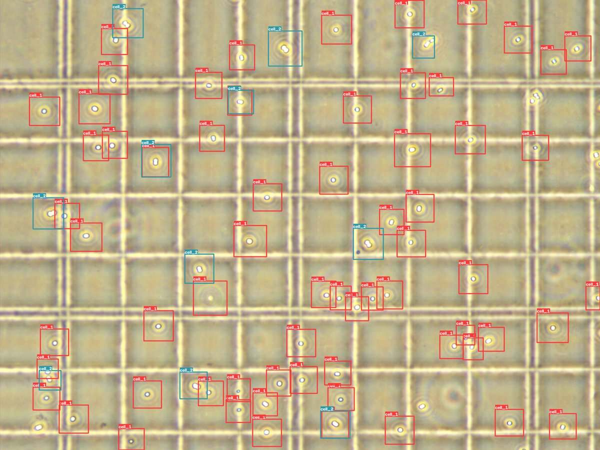

# frozen_paco

Automatic counting of algae cells on counting-chamber microscopy images.
A YOLO11n detector finds single cells and doublets; large images are processed tile by tile with [SAHI](https://github.com/obss/sahi), so it runs on an ordinary CPU-only PC.



## Classes

| class    | meaning                  | counts as |
|----------|--------------------------|-----------|
| `cell_1` | single cell              | 1         |
| `cell_2` | doublet (two cells)      | 2         |

`total = cell_1 + 2 × cell_2`

## Installation

Requires **Python 3.12**. The PyTorch build is CPU-only (~110 MB instead of several GB with CUDA).

```bash
git clone https://github.com/bodya67/frozen_paco.git
cd frozen_paco
python -m venv venv
source venv/bin/activate        # Windows: venv\Scripts\activate
pip install -r requirements.txt
```

**Offline machines** (no internet): download the ready bundle for your OS from [Releases](https://github.com/bodya67/frozen_paco/releases), copy it on a USB stick and install from the local wheels:

```bash
pip install --no-index --find-links=wheelhouse -r requirements.txt
```

## Usage

```bash
python frozen_paco.py -i input_folder -o output_folder -ct 0.5
```

| flag | meaning | default |
|------|---------|---------|
| `-i`, `--input`  | folder with images (`.jpg`, `.png`, `.tif`) | required |
| `-o`, `--output` | folder for results                          | required |
| `-ct`, `--conf`  | confidence threshold, 0–1                   | `0.5`    |

The default `0.5` gave the lowest counting error on the test set. Lower values find more cells but add false positives; higher values miss cells. If your images differ (microscope, magnification, lighting), check a few annotated outputs and adjust.

## Output

- `count_results.tsv` — one row per image: `img_name`, `cell_1`, `cell_2`, `total`
- one annotated PNG per image with every detected cell boxed

## Model

`models/best.pt` — YOLO11n, trained on 640×640 tiles of 4000×3000 images.

| metric | value |
|---|---|
| counting error, 12 full test images (`-ct 0.5`) | **4.8 cells / image (5.3 %)**, ~88 cells per image |
| detection (Ultralytics val, 640 px tiles) | P 0.81 · R 0.65 · mAP50 0.73 · mAP50-95 0.32 |

Counting error is the mean absolute difference between the predicted and annotated `total` per image.

Retraining: see [training/README.md](training/README.md).

## License

[AGPL-3.0](LICENSE), same as [Ultralytics YOLO](https://github.com/ultralytics/ultralytics), which this project depends on.
